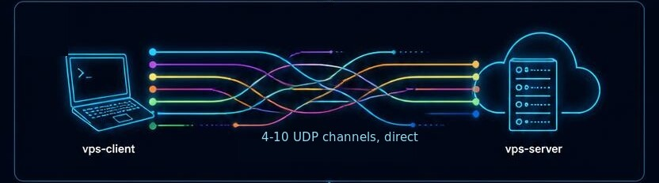
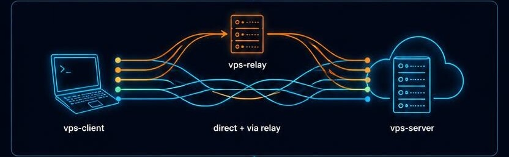
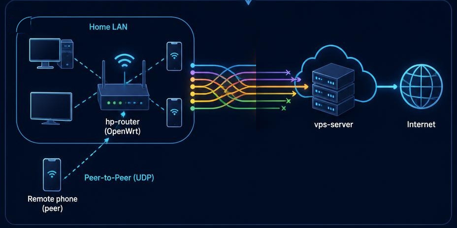

# home-proxy

Выходить в интернет с телефона **через свой дом**, откуда бы вы ни подключались: телефон
пробивается (UDP hole punching) до домашнего роутера или ПК, а дальше трафик идёт тем путём,
который вы выбрали дома — через свой VPS или свой домашний VPN. Проект — ответная мера на
попытки брать дополнительные деньги за международный мобильный трафик в РФ: с телефона уходит
трафик только до дома, за границу — уже из дома.

Две схемы:

- **роутер на OpenWrt** — `hp-router` держит туннель всего дома до вашего VPS и принимает
  телефоны ([схема](#схема-с-роутером-и-vps));
- **роутера нет** — телефон пробивается до домашнего ПК, ПК выпускает трафик через свой канал или
  VPN ([схема](#схема-с-домашним-пк)).

WireGuard не используется: трафик внутри и так почти весь HTTPS. Пакеты по дырам подписаны,
заголовки замаскированы ([Безопасность](#безопасность)).

## Установка: сервер и релей (`setup/`)

Скрипты запускаются с рабочей машины по ssh (алиасы из `~/.ssh/config`), состояние и GUID хранят
в `setup/state/` (не коммитится). Повторный запуск безопасен. Windows — `setup/win/*.bat`.
Подробности, переменные и проверки — [`setup/README.md`](setup/README.md).

Сервер — машина с белым IP (x86_64, Debian/Ubuntu, systemd). Нужен `cargo` и `protoc` на рабочей
машине: бинарники собираются локально и копируются на хост.

```bash
# 0. Свежий VPS (только root и пароль): положить ssh-ключ
SSHPASS='пароль' setup/ssh-key.sh root@<ip>

# 1. Сервер: ip_forward, NAT, порты в ufw; затем vps-server → /opt/hp-vps, служба hp-vps-server
setup/vps-prepare.sh <сервер>             # DRY_RUN=1 — только напечатать команды
setup/vps-server.sh  <сервер>

# 2. Клиент сервера (роутер OpenWrt или Linux): GUID, строка в clients.txt, служба, хуки DNS
setup/vps-client.sh <клиент> [сервер]
#    сервер + клиент одной командой:
setup/vps-client-router-vps-server.sh <сервер> <клиент>

# 3. Релей (необязательно): вторая машина с белым IP, через неё идёт часть дыр клиентов
setup/vps-relay.sh <релей> <сервер>
```

- Порты по умолчанию: знакомство `40600/udp`, дыры `40601–40699/udp`, туннель `10.94.0.0/24`.
- Сборка клиента под роутер: `PACKAGES=vps-client TOOLCHAIN_DIR=… OpenWRT/build.sh` (по одному
  пакету за вызов), см. [`OpenWRT/`](OpenWRT/README.md).
- Каждый новый клиент — отдельный `vps-client.sh`; сервер подхватывает строку в `clients.txt` за
  ~2 с без перезапуска.
- **Релей** для клиента — такой же сервер; пакеты перекладывает на настоящий, ключей клиентов не
  знает. К серверу приходит сам по своему GUID (`relays.txt`). Новый релей — перезапуск службы
  сервера (у его клиентов несколько секунд без дыр). Доля дыр через релеи — `VPS_RELAY_SHARE`
  (%, по умолчанию 50). Входящий UDP на порты релея должен проходить: при активном ufw скрипт
  открывает сам, при `INPUT DROP` без ufw — предупреждает. Второй экземпляр сервера:
  `SERVER_DIR=… SERVER_UNIT=… setup/vps-relay.sh <релей> <сервер>`.
- Роутер с работающим OpenVPN: сначала остановить его (`/etc/init.d/openvpn stop`).
- Проверка: в конце `vps-client.sh` — не меньше 4 дыр в работе и маршруты; потом
  `hpctl --connect <строка> status`.

### Windows

Для Windows есть аналоги: `setup\win\*.bat` (`vps-prepare.bat`, `vps-server.bat`, `vps-client.bat`,
`vps-relay.bat`, `vps-client-remove.bat`) — настраивают Linux-сервер и релей по ssh и ставят
`vps-client` на этот же ПК (задача планировщика, Wintun). Запускать из консоли администратора;
`DRY_RUN=1` — только напечатать план. Подробности — [`setup/win/README.md`](setup/win/README.md).
Ограничение: Linux-бинарники `vps-server` и `vps-relay` Windows не соберёт — соберите их в WSL
(`cargo build --release -p vps-server`) и укажите `VPS_SERVER_BIN=путь` / `VPS_RELAY_BIN=путь`.

### Установка cargo (Rust) с нуля

`cargo` — сборщик Rust, нужен, чтобы собирать бинарники из исходников. Один раз:

**Windows**

1. Откройте PowerShell и поставьте инструменты (или скачайте установщики вручную):
   ```powershell
   winget install Rustlang.Rustup                  # rustup: ставит cargo и компилятор
   winget install Microsoft.VisualStudio.2022.BuildTools --override "--passive --add Microsoft.VisualStudio.Workload.VCTools --includeRecommended"
   winget install Git.Git                          # git, ssh и bash (нужен для vps-prepare.bat)
   ```
   Сборка Rust на Windows требует C++ Build Tools: в установщике Visual Studio должна быть
   отмечена нагрузка «Разработка классических приложений на C++».
2. `protoc` (обязателен, без него проект не соберётся): скачайте `protoc-*-win64.zip` со
   страницы [protobuf releases](https://github.com/protocolbuffers/protobuf/releases), распакуйте,
   например, в `C:\tools\protoc` и добавьте `C:\tools\protoc\bin` в `PATH` (или задайте
   `set PROTOC=C:\tools\protoc\bin\protoc.exe`).
3. Закройте и откройте терминал заново, проверьте: `cargo --version`, `protoc --version`, `git --version`.

**Linux / WSL (Debian, Ubuntu)**

```bash
sudo apt install -y build-essential protobuf-compiler git curl
curl --proto '=https' --tlsv1.2 -sSf https://sh.rustup.rs | sh   # на все вопросы — Enter
. "$HOME/.cargo/env"
cargo --version && protoc --version
```

Дальше: `git clone https://github.com/sinushkin/home-proxy` и `cargo build --release -p vps-server`
(результат — `target/release/`). Первая сборка занимает несколько минут. Для роутера нужен ещё
кросс-тулчейн OpenWrt — [`OpenWRT/README.md`](OpenWRT/README.md).

Рандеву (STUN + MQTT по TLS) нужно только для P2P-схем (телефон ↔ роутер/ПК) и ставится отдельно:
[`docker-compose.yml`](docker-compose.yml), [`cert/`](cert/README.md), [`mosquitto/`](mosquitto/README.md).
Телефон — приложение [`android-vpn/`](android-vpn/README.md). Связка телефона с `hp-server` —
`setup/README.md`, раздел 2.

## Схема с роутером и VPS

```
телефон ══ 4–10 P2P-дыр (пробив через NAT) ══ hp-router (дом) ══ 4–10 дыр на порты VPS ══ vps-server ── интернет
   └──── адрес через STUN + MQTT ────┘
```

`hp-router` (один бинарник ~2 МБ) делает две вещи:

1. **Шлюз дома.** Трафик LAN и Wi-Fi уходит в `hp0` и по дырам к VPS, откуда выходит через NAT.
2. **Пир для телефонов.** Для каждого телефона — свой набор дыр (проброс портов не нужен). Пакеты
   телефона роутер не разбирает: кладёт в дыры к VPS с номером телефона (`client_id`), ответы —
   обратно.

**Набор дыр динамический:** от 4 до 10 в работе, каждая живёт случайные 3–10 минут, затем
сливается по договорённости с пиром и заменяется новой на другом порту; трафик не прерывается.
Дыра с потерями выше порога уходит раньше.

Телефон: IP-пакеты из системного TUN уходят по дырам как есть. Адрес и DNS выдаёт VPS (роутеры и
хосты — `10.80.0.x`, телефоны — `10.80.1.x`+, постоянные). Пакеты идут по дырам вперемешку: TCP
нумеруется внутри соединения, порядок восстанавливает конечный получатель; UDP и ICMP — сразу.

**Проверено.** 2026-09-26: Android на LTE → Xiaomi Mi Router 4C (MT7628) → VPS: 14 Мбит/с приём,
7 отдача; дома через роутер ~25 Мбит/с (упор в CPU). 2026-10-10 (динамические дыры): телефон на
хотспоте iPhone → `hp-router` (MT7621) → VPS: дыры 9–10/10, TCP 16.8 Мбит/с одним соединением и
19.7 четырьмя. Замеры — [`Performance.md`](Performance.md).

Нужно: VPS ([`vps-server/`](vps-server/README.md), [`OpenWRT/Tun.md`](OpenWRT/Tun.md)); роутер с
`kmod-tun` (маршрут по умолчанию в `hp0` только для LAN, flow offloading — `OpenWRT/Tun.md`);
рандеву-сервер; Android-приложение (GUID телефона и роутера: пара `PHONE_<n>_*` или пакет
сопряжения из трея); трей на ПК по желанию ([`control/`](control/README.md): состояние, потери по
дырам, «Добавить телефон» по QR; связь — по строке подключения из LuCI, Службы → Home Proxy).

## Схема с домашним ПК

```
телефон ══ 10 P2P-дыр ══ hp-server (ПК) ── домашний канал / ваш VPN ── интернет
```

`hp-server` — тот же сервер, что и на VPS. Linux: пакеты телефона в `hp0` и через NAT
(`MODE=tun`, с настоящим телефоном пока не проверялся). Windows: свой сетевой стек в процессе,
без WSL и прав администратора (`MODE=netstack`, [`windows/`](windows/README.md); запасной вариант —
WSL2, [`wsl/`](wsl/README.md)). Если на ПК включён VPN, дыры идут мимо него через физический
адаптер, трафик телефона — через VPN. Настройка — [`hp-server/`](hp-server/README.md).
Проверено 2026-10-10 (Linux и Windows, хотспот iPhone): дыры 10/10, пинг без потерь, TCP ~4 Мбит/с
одним соединением (окно 64 КБ) и 12–15 Мбит/с четырьмя.

## Проверка статусов

Всё берётся из памяти служб по протоколу управления (`control/`), на диск ничего не пишется.

- **Сервер (VPS):** `setup/hp-status.sh` на сервере — клиенты, дыры (адрес, возраст, релей, потери),
  счётчики событий, релеи; `-e N` — последние N событий. Нужен `CONTROL_ADDR` в настройках службы.
  Напрямую: `hpctl --addr 127.0.0.1:47011 --key-file /opt/hp-vps/control.key status` (или `events 20`).
- **Роутер / клиент VPS:** `hpctl --connect '<строка подключения>' status` (строка — LuCI или
  `hp-router --connection-string`). Сравнение путей (напрямую и через релеи, чёрный список) — в
  журнале раз в минуту: `logread | grep -E 'потери по путям|чёрный список|срок чёрного'` (OpenWrt),
  `journalctl -u hp-vps-client | grep …` (Linux). Отчёт по роутеру — `setup/router-status.sh`.
- **ПК:** трей `hp-tray` — то же для всех служб из `tray.conf`, цвет по потерям
  ([`control/README.md`](control/README.md)).

## Режимы работы клиента и VPS

Клиент (`vps-client`, `hp-router`) соединяется с `vps-server` не одним каналом, а набором: от 4 до
10 UDP-каналов в работе, каждый живёт случайные 3–10 минут, затем заменяется новым; трафик идёт
вперемешку по всем, без обрыва. «Дырами» эти каналы не называем: пробив NAT (hole punching) нужен
только телефону, который соединяется с домашним ПК или роутером ([схема](#схема-с-домашним-пк)).

### Напрямую



Все каналы идут от клиента к серверу напрямую. Это основной режим: у сервера белый IP, пробив не
нужен.

### Напрямую и через релей



Необязательный режим: сервер разрешает клиенту вести долю новых каналов через `vps-relay`
(вторая машина с белым IP), остальные идут напрямую. Путь с большими потерями на 10 минут
исключается; если прямой путь недоступен, новые каналы идут через релей.

### Домашний роутер



`hp-router` (OpenWrt) — клиент `vps-server` для всего дома: трафик LAN и Wi-Fi уходит по набору
каналов к VPS и выходит в интернет. Удалённый телефон соединяется с роутером напрямую
(пробив NAT, дыры; [схема](#схема-с-роутером-и-vps)), а от роутера его трафик идёт теми же
каналами к VPS.

**Раздельное туннелирование.** Адреса и подсети из списка (например, российских сайтов) роутер
пускает мимо VPN напрямую через WAN, остальное идёт в туннель. Список свой на каждом роутере,
настройка — [`openwrt-k-router/`](openwrt-k-router/README.md).

## Как работают дыры

1. Оба конца заранее знают **полный GUID** друг друга (например, по QR). Наружу уходит только
   **имя** — первая группа GUID. Из двух GUID выводится общий секрет и все ключи.
2. Оба спрашивают у STUN свой внешний адрес и через MQTT оставляют друг другу подписанные записи.
   Брокер и STUN нужны только для встречи.
3. Затем оба **одновременно шлют пакеты друг другу**, NAT открывает «дыры»: проброс портов и белый
   IP дома не нужны. Порты перебираются широким диапазоном на случай, если NAT сменил порт.
4. Пока живых дыр нет, адреса идут через MQTT; после первой пробитой остальные договариваются по
   ней. Ролей нет: кто начал, тот начал; пир открывает ответную, если у него дыр меньше 10.
   Keep-alive со случайным периодом, данные — в случайную дыру.

## Безопасность

- **Подпись:** в начале пакета метка ChaCha20-Poly1305 и счётчик; подписаны первые 128 байт и
  длина. Без полных GUID пакет не подделать, не вставить, не обрезать, не повторить; неверный
  отбрасывается, адрес пира не меняет. Дальше 128-го байта испортить может только тот, кто на
  пути, — HTTPS это заметит.
- **Шифрования нет** намеренно: содержимое — HTTPS. XOR лишь маскирует подпись и заголовки.
- **Полные GUID — секрет.** На брокере — только имена и подписанные адреса; в логах и статусе — только имена.
- **Управление** (трей, `hpctl`, LuCI) — только loopback или LAN, канал зашифрован ключом строки
  подключения. Строка и QR сопряжения — секреты; при утечке — «Новая строка подключения».
- **Экспериментальный проект**, аудита кода не было.

## Оговорки

- Телефон и дом не должны быть за одним внешним адресом (нет hairpin NAT).
- Версии P2P несовместимы с прежними: телефон, роутер и `hp-server` обновляются вместе.
- На MT7628 (580 МГц) потолок ~25–30 Мбит/с.
- Для iPhone клиента нет: [`iPhone/README.md`](iPhone/README.md).

## Состав

| Каталог | Что |
|---|---|
| `setup/` | скрипты установки сервера, релея и клиентов (`.sh`; `.bat` в `setup/win/`) |
| `hp-backend/` | Rust-библиотеки: протокол, подпись, пробив (`connection`), TUN, Android-ядро; `peer` для проверок |
| `hp-router/` | роутер OpenWrt: шлюз дома к VPS + пир для телефонов |
| `vps-server/`, `vps-client/`, `vps-relay/` | VPS-схема: сервер, клиент (роутер/хост), релей |
| `hp-server/` | служба на домашнем ПК |
| `android-vpn/` | приложение Android |
| `OpenWRT/` | сборка под роутеры, TUN, ускорение |
| `control/` | управление: протокол, трей, `hpctl`, сопряжение по QR |
| `windows/`, `wsl/` | ПК на Windows: нативный `hp-server.exe`; запасной образ WSL2 |
| `cert/`, `mosquitto/`, `coturn/` | TLS, MQTT и STUN для рандеву |
| `iPhone/` | заметки про iOS |

Замеры — [`Performance.md`](Performance.md). Протокол — [`hp-backend/connection/README.md`](hp-backend/connection/README.md), [`CLAUDE.md`](CLAUDE.md).

## TODO

- Проверить `hp-server` на `MODE=tun` (Linux) с настоящим телефоном.
- Служба Windows для `hp-server.exe`; проверить трей на Windows в интерактивном сеансе.
- `hp-router`: перезагрузка firewall после запуска (flowtable) пока руками — `OpenWRT/Tun.md`.
- Разобрать, почему у телефона на мобильном канале RTT и потери выше, чем у роутера.

## Лицензия

[MIT](LICENSE).
